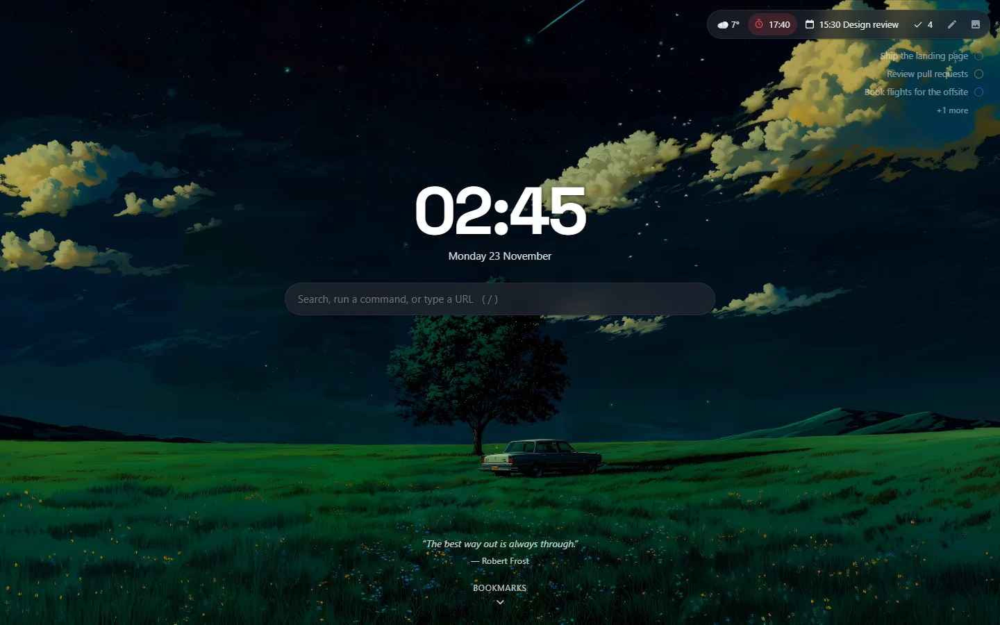
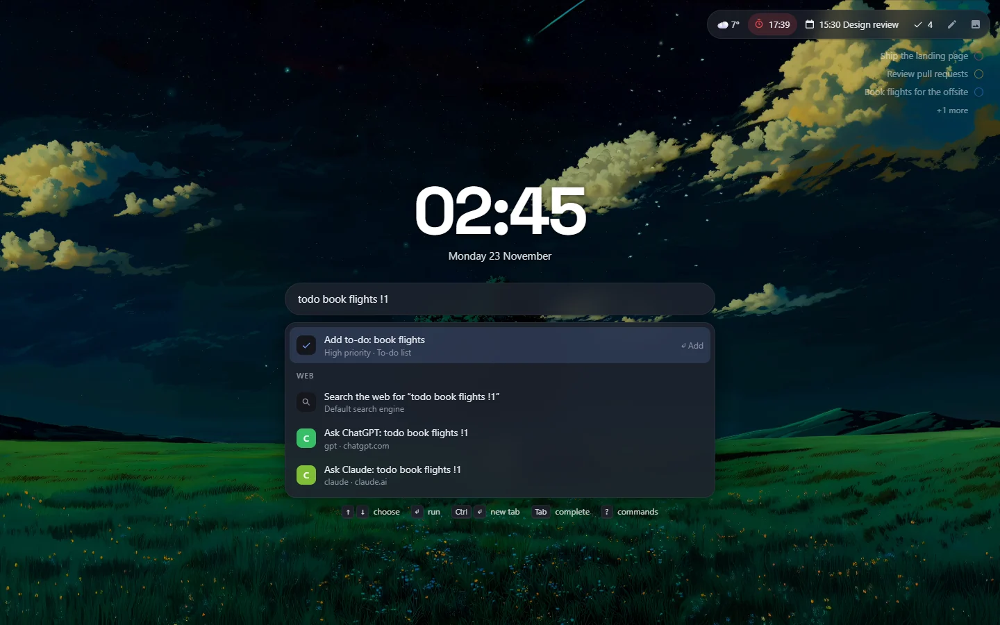
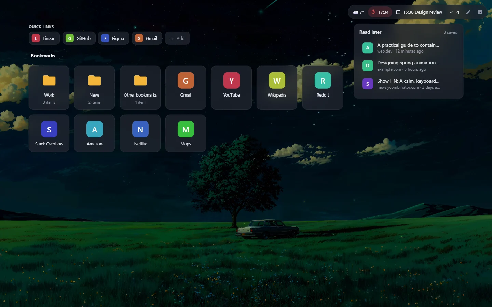
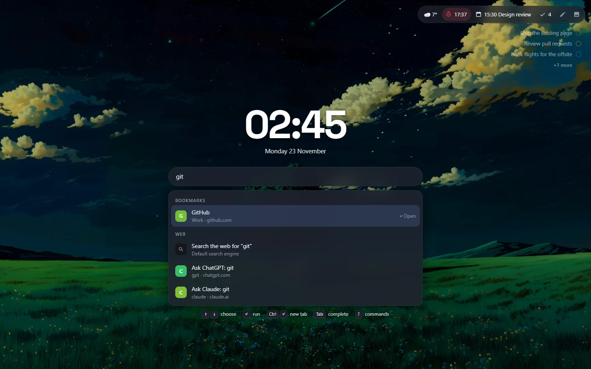
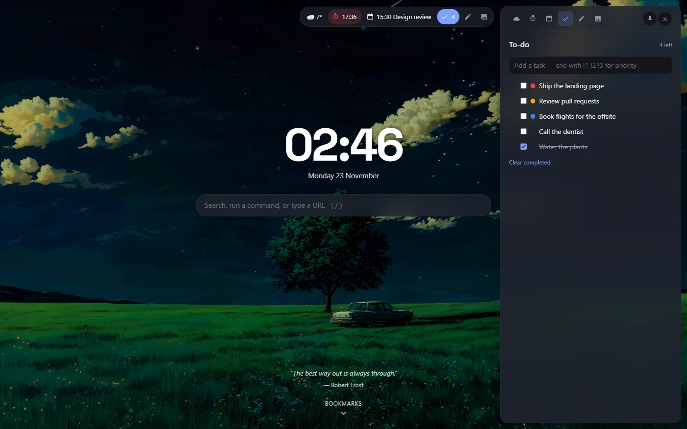

# Hearth — a calm, keyboard-first new tab page for Chrome

**Hearth** is a minimal **new tab extension for Google Chrome** that turns every new tab into a quiet home base:
a big clock and a **command palette** up front, your **bookmarks**, **quick links** and **read later** list one
scroll away, and **to-dos**, a **pomodoro timer**, **weather**, a **calendar** and **notes** one keystroke away.
It works with an image or **video wallpaper**, keeps all your data on your computer, and needs no account.

- **Minimal by default** — just the clock and a search box until you need something else.
- **Keyboard-first** — the search box has the cursor when a tab opens; `/` or `Ctrl+K` brings you back from anywhere.
- **Private** — no account, no analytics, no tracking. Everything is stored locally in your browser.
- **Fast and smooth** — spring-based page transitions that stay smooth on high-refresh displays and over video backgrounds.

---

## Contents
- [Features](#features)
- [Screenshots](#screenshots)
- [Install](#install)
- [Command palette](#command-palette)
- [Keyboard shortcuts](#keyboard-shortcuts)
- [Privacy and permissions](#privacy-and-permissions)
- [FAQ](#faq)
- [Project structure](#project-structure)
- [License](#license)

---

## Features

### Command palette (search box)
One box for everything: **search bookmarks**, **search your browsing history with address-bar-style autofill**
(`h google.c`), open a **URL**, do **quick maths**, **search the web** with
your default engine or a specific one (Google, DuckDuckGo, Bing, Brave, YouTube, Wikipedia, GitHub, Reddit,
Stack Overflow, MDN, npm, Google Maps), or **ask ChatGPT or Claude** with your text as the prompt. It also runs
commands — `todo buy milk`, `note …`, `event fri 2pm dentist`, `focus`, `weather` — without leaving the keyboard.
Instant "Opening…" feedback means one Enter is always enough. [All commands ↓](#command-palette)

### Bookmarks, quick links and read later
- **Bookmark grid** with folders, breadcrumbs and site icons, on a second page below the clock (scroll, click
  "Bookmarks ⌄" or press `↓`). Updates live when your bookmarks change.
- **Manage bookmarks right in the grid**: **+ Add** a bookmark or folder; use **⋯** (or right-click a tile) to
  edit, rename, move to another folder or delete (it asks first, then offers **Undo**); **drag tiles** to reorder them, drop one onto
  a folder to move it inside, or onto the folder path at the top to move it up. Changes go straight to Chrome's
  bookmarks.
- **Quick links**: pin any bookmark with the ☆ on its tile, or add your own link. Edit a link's name or address
  with ✎, remove it with ×, reorder by dragging. (Renaming a pinned bookmark here leaves the bookmark itself alone.)
- **Read later list**: right-click any page or link → *Add to Read Later*. The list sits beside your
  bookmarks; ✓ marks an article as read.

### To-do list with priorities
- Add tasks from the palette (`todo pay rent !1`) or the to-do drawer (`T`).
- **Priorities** High / Medium / Low (`!1` `!2` `!3`), **drag to reorder** (or use the keyboard), sort by priority.
- **Always in view, never in the way**: your top 3 open tasks sit faintly under the corner icons, highest
  priority first, and brighten on hover. Their text colour adapts to the wallpaper behind them.

### Pomodoro timer
25 / 5 / 15-minute focus and break sessions with a long break every 4 focus sessions. Keeps running when you
close the tab and sends a **desktop notification** when a session ends. The tab title shows the countdown.

### Weather, calendar, notes and daily quote
- **Weather** for any city with a 5-day forecast — free [Open-Meteo](https://open-meteo.com) data, no API key,
  no location permission.
- **Calendar** with a month view and events (`event tomorrow 9:30 standup`).
- **Notes**: a notepad that saves as you type.
- **Quote of the day**, fetched once a day (can be turned off).

### Make it yours
- **Custom background**: upload an **image or video** (up to 500 MB) or paste a link; a dim slider keeps text
  readable. Videos play muted, loop, and pause in background tabs.
- **Move the clock and search box** to any of 8 positions.
- **Light and dark mode** follow your system; reduced-motion settings are respected.
- **Dock** of live status chips (weather, timer, next event, open tasks) that open each widget in a side drawer,
  which can be pinned open.

---

## Screenshots

| Command palette | Bookmarks, quick links & read later |
|---|---|
|  |  |
| **Search** | **To-do list with priorities** |
|  |  |

---

## Install

Hearth isn't on the Chrome Web Store yet; install it from source in a minute:

1. Download or clone this repository.
2. Open `chrome://extensions` in Chrome.
3. Turn on **Developer mode** (top right).
4. Click **Load unpacked** and select the project folder.
5. Open a new tab.

Built and tested in Chrome; it should also work in other Chromium browsers with Manifest V3 support (Edge,
Brave, Arc, Vivaldi). To update after pulling changes, click **Reload** on the extension in `chrome://extensions`.

Tip: Chrome shows a small bar at the bottom of any replaced new tab page. In recent versions you can hide it
under *Customize Chrome* → *Footer*.

---

## Command palette

Type in the search box on the home page. `?` lists every command.

| Type | Does |
|------|------|
| `todo buy milk` (or `t …`) | adds a to-do; `todo pay rent !1` adds it with high priority |
| `note call the bank` (or `n …`) | appends a line to your notes |
| `event fri 2pm dentist` | adds a calendar event — `today` / `tomorrow` / weekday and `14:30` / `2pm` are optional |
| `focus`, `break`, `long break`, `pause`, `reset`, `skip` | controls the pomodoro timer |
| `weather`, `city`, `units`, `calendar`, `todos`, `notes`, `background` | opens that widget (or changes the city / °C–°F) |
| `bookmarks` | goes to the bookmarks page |
| `later` | jumps to the read later list |
| `quote` | shows / hides the daily quote |
| `position top left`, `position bottom`, … | moves the clock and search box (`position` alone opens the picker) |
| `12*4.5`, `=2^10` | calculates; `Enter` copies the result |
| `github.com`, `localhost:3000` | opens the address |
| `h google.c` (or `history …`) | searches your browsing history and **autofills the address** like Chrome's address bar (`Tab` / `→` accepts, `Backspace` / `Esc` drops it) |
| `yt lofi beats`, `g …`, `ddg …` | searches a specific engine (keywords below) |
| `gpt explain closures`, `claude …` | opens ChatGPT / Claude with your text as the prompt |
| anything else | matching bookmarks, folders, quick links and saved pages, then web search, Ask ChatGPT, Ask Claude |

**Search engine and AI keywords** — type the keyword, a space, then your text:

| Engine | Keyword | | Engine | Keyword |
|---|---|---|---|---|
| Google | `g` | | GitHub | `gh` |
| DuckDuckGo | `ddg`, `d` | | Reddit | `r` |
| Bing | `b` | | Stack Overflow | `so` |
| Brave Search | `br` | | MDN | `mdn` |
| YouTube | `yt` | | npm | `npm` |
| Wikipedia | `w`, `wiki` | | Google Maps | `maps` |
| **ChatGPT** | `gpt`, `chat` | | **Claude** | `claude`, `cl` |

ChatGPT and Claude receive the prompt through the link (`chatgpt.com/?q=…`, `claude.ai/new?q=…`); whether it's
sent automatically or just filled in is up to each site. Add or change engines in `ENGINES` in `palette.js`.

---

## Keyboard shortcuts

| Key | Action |
|---|---|
| `/` or `Ctrl+K` | focus the command palette |
| `↑` `↓` · `Enter` · `Ctrl+Enter` · `Tab` · `Esc` | choose · run · open in a new tab · complete a command · clear, then leave |
| `↓` (empty search box), `PageDown`, `Space` | go to the bookmarks page |
| `↑`, `PageUp` (at the top of the grid) | back to the home page |
| `W` `P` `C` `T` `N` `B` | open Weather · Pomodoro · Calendar · To-do · Notes · Appearance (when not typing) |
| `R` | jump to the read later list |
| `Backspace` | up one bookmark folder |
| `Esc` | leave a text field; again to close the drawer |

On the bookmarks page, focus a to-do's grip and press `↑` / `↓` to reorder it; in the calendar, arrow keys and
`PageUp` / `PageDown` move between days and months.

---

## Privacy and permissions

Hearth has **no account, no analytics and no tracking**. Your bookmarks, to-dos, notes, events, quick links,
read later list and settings are stored **locally** in your browser (`chrome.storage.local`, and IndexedDB for
an uploaded wallpaper). Nothing is synced to a server.

Hearth only contacts these services, and only for the feature you use:

| Service | When | What is sent |
|---|---|---|
| [Open-Meteo](https://open-meteo.com) | weather, once you pick a city (cached 30 min) | the city's coordinates, or the name you search for |
| [DummyJSON](https://dummyjson.com) | daily quote, once a day (off = never) | nothing but the request |
| your search engine / ChatGPT / Claude / other sites | only when you open them | what you typed, as a normal visit |
| a wallpaper link you paste | when the background loads | a normal request for that image or video |

| Permission | Why |
|---|---|
| `bookmarks` | show, search and organize your bookmarks |
| `favicon` | show site icons from Chrome's own icon cache |
| `storage` | keep your to-dos, notes and settings on your computer |
| `search` | search with *your* default search engine |
| `alarms`, `notifications` | end pomodoro sessions on time and tell you |
| `contextMenus`, `activeTab` | the right-click *Add to Read Later*; the page title is read only when you click it |
| `history` *(optional)* | only if you use `h …` history search: Hearth asks the first time, and it's never requested otherwise. History is read locally and never sent anywhere |

No location permission is requested. When you add Hearth, Chrome asks you to confirm the parts that affect you:
replacing the new tab page, reading and changing your bookmarks, and showing notifications.

---

## FAQ

**How do I replace the new tab page in Chrome with Hearth?**
Load it as shown in [Install](#install); Chrome then opens Hearth on every new tab. To go back, disable or
remove the extension in `chrome://extensions`.

**Why does the address bar show `chrome-extension://…?focus` instead of being empty?**
Chrome keeps the cursor in the address bar on new tabs. To put it in Hearth's search box instead, the page
reloads itself once with `?focus` (see `focus.js`); the visible address is the trade-off.

**Can I use a video as my new tab background?**
Yes. Open Appearance (`B`), upload an MP4 / WebM video (or paste a link) and adjust the dim slider. Videos play
muted on a loop, pause when the tab isn't visible, and page transitions stay smooth.

**Does it work offline?**
Yes — everything except weather and the daily quote, which keep their last result when offline.

**Can I sync my to-dos and notes between computers?**
Not yet: all data stays on the computer it was created on.

**Does Hearth work in Microsoft Edge, Brave or Arc?**
It should work in any Chromium browser with Manifest V3 support, but it's developed and tested in Chrome only.

---

## Project structure

| File | Role |
|---|---|
| `manifest.json` | extension manifest (Manifest V3) |
| `newtab.html`, `newtab.css` | the new tab page |
| `newtab.js` | bookmark grid and folders |
| `bookmarks-manage.js` | adding, editing, moving, deleting and dragging bookmarks |
| `pages.js` | the two pages and their spring transition |
| `palette.js` | command palette |
| `dock.js` | status chips and the drawer |
| `widgets.js` | to-dos and notes |
| `weather.js`, `calendar.js`, `pomodoro.js`, `pomodoro-core.js` | widgets |
| `quicklinks.js`, `readlater.js`, `quote.js` | quick links, read later, daily quote |
| `background.js`, `tone.js`, `layout.js` | wallpaper, text colour over it, clock position |
| `focus.js`, `storage.js` | autofocus, local storage helper |
| `sw.js` | service worker: pomodoro alarms and notifications, right-click menu |

Opening `newtab.html` directly in a browser (outside the extension) shows sample bookmarks, which is handy for
working on the layout.

---

## License

Hearth is free and open source under the [MIT License](LICENSE). The font bundled in `fonts/` keeps its own
license (`fonts/OFL.txt`).
